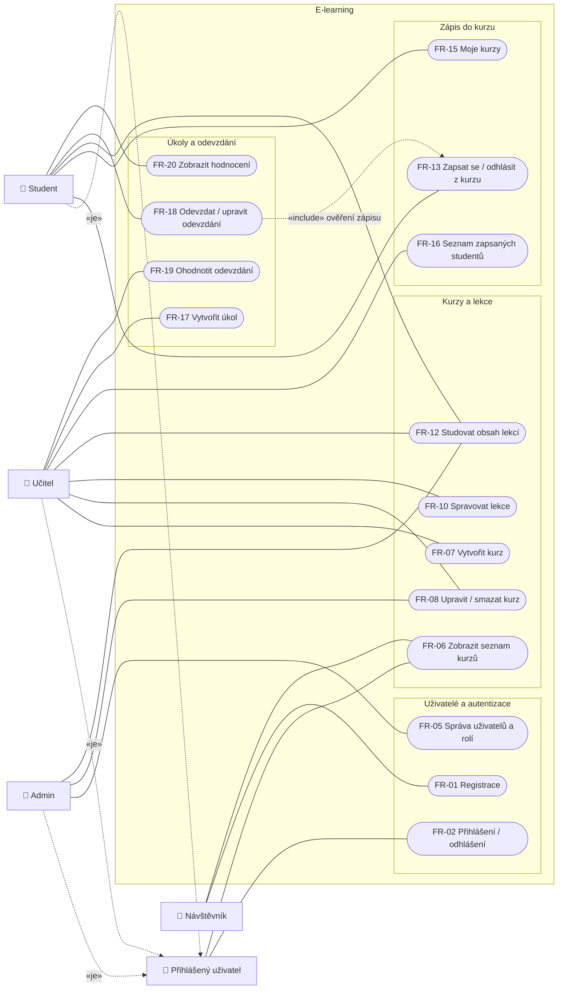
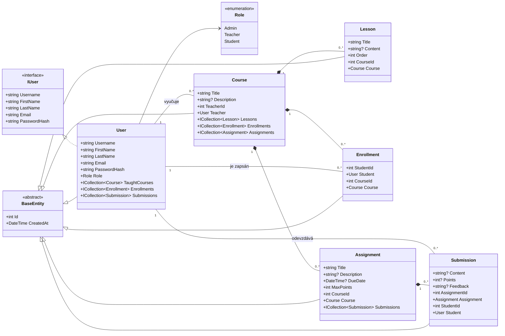
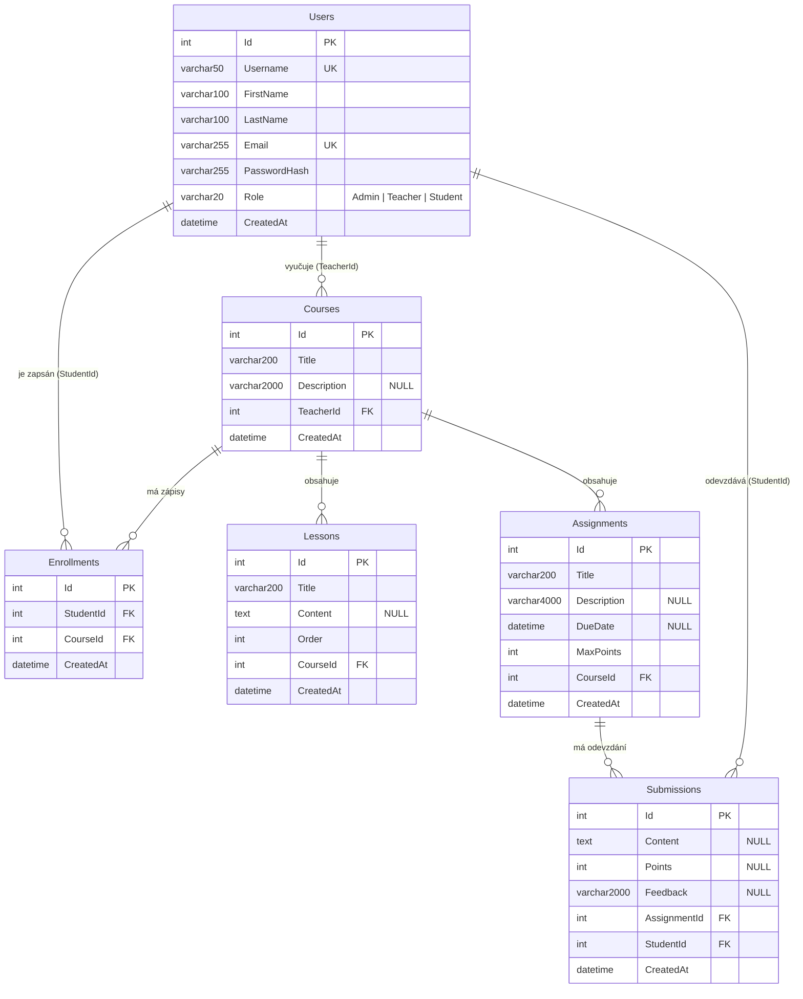

# Návrh aplikace – E-learning.
## 1. Role uživatelů

| Role | Popis |
|---|---|
| **Admin** | Spravuje uživatele a má přístup ke všem kurzům. |
| **Teacher** (učitel) | Vytváří a spravuje své kurzy, lekce a úkoly, hodnotí odevzdání. |
| **Student** | Zapisuje se do kurzů, prochází lekce, odevzdává úkoly. |
| **Nepřihlášený návštěvník** | Vidí pouze veřejný seznam kurzů. |

## 2. Funkční požadavky

### Diagram případů užití

Přerušovaná šipka `«je»` znamená dědění role.

### Uživatelé a autentizace
- **FR-01** Návštěvník se může zaregistrovat (uživatelské jméno, jméno, příjmení, e-mail, heslo). Nový účet má roli Student.
- **FR-02** Uživatel se může přihlásit a odhlásit.
- **FR-03** Uživatelské jméno i e-mail jsou v systému unikátní.
- **FR-04** Heslo se ukládá pouze jako hash, nikdy v čitelné podobě.
- **FR-05** Admin může zobrazit seznam uživatelů, měnit jejich role a mazat je.

### Kurzy
- **FR-06** Kdokoli může zobrazit seznam kurzů (název, popis, vyučující).
- **FR-07** Učitel může vytvořit kurz; stává se jeho vyučujícím.
- **FR-08** Učitel může upravit a smazat svůj kurz (Admin libovolný kurz).
- **FR-09** Učitele, který vyučuje alespoň jeden kurz, nelze smazat (nejdříve je nutné kurzy smazat nebo předat).

### Lekce
- **FR-10** Učitel může do svého kurzu přidávat, upravovat a mazat lekce.
- **FR-11** Lekce mají pořadí; v detailu kurzu se zobrazují seřazené.
- **FR-12** Obsah lekcí vidí pouze studenti zapsaní v kurzu, vyučující a Admin.

### Zápis do kurzu
- **FR-13** Student se může zapsat do kurzu a odhlásit se z něj.
- **FR-14** Student může být do jednoho kurzu zapsán nejvýše jednou.
- **FR-15** Student vidí seznam kurzů, do kterých je zapsán.
- **FR-16** Učitel vidí seznam studentů zapsaných ve svém kurzu.

### Úkoly a odevzdání
- **FR-17** Učitel může v kurzu vytvořit úkol (název, zadání, termín odevzdání, maximální počet bodů).
- **FR-18** Zapsaný student může úkol odevzdat; ke každému úkolu má nejvýše jedno odevzdání, které může do termínu upravit.
- **FR-19** Učitel vidí odevzdání ke svým úkolům a může je ohodnotit (body 0 až max. body, slovní zpětná vazba).
- **FR-20** Student vidí hodnocení a zpětnou vazbu ke svým odevzdáním.

### Mazání (kaskády)
- **FR-21** Smazáním kurzu se smažou jeho lekce, úkoly, odevzdání a zápisy.
- **FR-22** Smazáním studenta se smažou jeho zápisy a odevzdání.

## 3. Návrh entit a databáze

### Doménový model (entity v kódu)

### ER diagram

### Popis entit

Všechny entity dědí z `BaseEntity` (`Id` – primární klíč, `CreatedAt` – čas vytvoření v UTC).

| Entita | Význam | Klíčová pravidla |
|---|---|---|
| **User** | Uživatel systému s rolí Admin / Teacher / Student. | `Username` a `Email` unikátní; `Role` uložena jako text. |
| **Course** | Kurz vedený jedním učitelem. | FK `TeacherId → Users`, `ON DELETE RESTRICT` (FR-09). |
| **Lesson** | Výuková lekce v kurzu. | FK `CourseId → Courses`, kaskádové mazání; `Order` určuje pořadí. |
| **Enrollment** | Zápis studenta do kurzu – vazební tabulka M:N mezi `Users` a `Courses`. | Unikátní dvojice `(StudentId, CourseId)` (FR-14); kaskáda z obou stran. |
| **Assignment** | Úkol v kurzu. | FK `CourseId → Courses`, kaskádové mazání. |
| **Submission** | Odevzdání úkolu studentem, včetně hodnocení. | Unikátní dvojice `(AssignmentId, StudentId)` (FR-18); `Points`/`Feedback` vyplní učitel. |

### Vazby

| Vazba | Kardinalita | Realizace |
|---|---|---|
| Učitel – Kurz | 1 : N | `Courses.TeacherId` |
| Student – Kurz | M : N | přes `Enrollments` |
| Kurz – Lekce | 1 : N | `Lessons.CourseId` |
| Kurz – Úkol | 1 : N | `Assignments.CourseId` |
| Úkol – Odevzdání | 1 : N | `Submissions.AssignmentId` |
| Student – Odevzdání | 1 : N | `Submissions.StudentId` |

## 4. Architektura

| Projekt | Vrstva | Obsah |
|---|---|---|
| `PW.Elearning.Domain` | Doménová | Entity, enum `Role`, rozhraní `IRepository<T>`, `ICourseRepository`, `IUnitOfWork`. Nezávisí na ničem. |
| `PW.Elearning.Application` | Aplikační | Služby a DTO (např. `CourseService`, `CourseDto`). Závisí pouze na Domain. |
| `PW.Elearning.Infrastructure` | Infrastruktura | EF Core `ElearningDbContext`, Fluent API konfigurace, migrace, implementace `Repository<T>` a specifických repozitářů. |
| `PW.ELearning.Web` | Prezentační | ASP.NET Core MVC – controllery a views; skládá vrstvy pomocí DI. |
